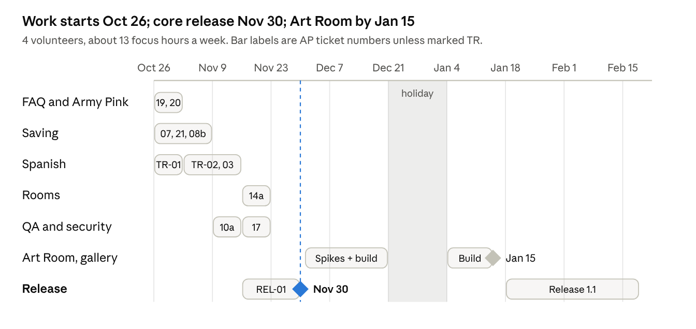

# Army Pink Wellness Portal — Technical Plan

_Last updated 26 October 2026. Developers: start with the [Developer Onboarding guide](developer-onboarding.md)._

## Executive summary

The Wellness Portal is a free, anonymous website that Army Pink is building for survivors of domestic violence. It releases on **30 November 2026**. Visitors can calm down, reflect, learn, find opportunities and create art without creating an account. Anything they choose to save stays on their own device.

- **Where we are.** The foundation is complete and tested, and 92 automated tests pass. The site builds and runs, and the privacy choice and device-only saving work end to end. Most content is still placeholder text.
- **How it is built.** The Portal is a static website with no backend server. That one decision removes the biggest privacy risk, a central store of survivors' data, and keeps the project cheap and simple for a volunteer team to run. Section 4 explains why.
- **What happens next.** Team work starts **this week, Monday 26 October**. Five weeks remain before the 30 November launch, with Thanksgiving week at half capacity.
- **What the founder's brief adds.** The founder's final brief of 26 October requires a 9-question FAQ, an optional About Army Pink link, consistent privacy wording and readable text files in the download. That is about 11 hours of new work, scheduled before launch. It also asks for sharing to an Anonymous Survivor Art Gallery, which needs a server; see decision D7.
- **What changed in scope.** The team is 4 volunteer developers giving about 5 hours a week, roughly 13 focused hours in total. That covers about 55 hours before launch. To make room, behind-the-scenes refactoring (moving content to JSON, shared components) and other polish move to **Release 1.1, targeted for 19 February 2027**. Visitors won't notice these changes. The full Art Room stays targeted for 15 January 2027, and the basic canvas ships at launch.
- **What we need from leadership.**
  - a decision on gallery sharing (D7) and on the Esc wording (D4)
  - agreement to launch on 30 November with the deferred items listed in section 9
  - an owner for real content and for Spanish review
  - approval of the wording listed in section 11

## About this document

This is the working technical plan for the Portal. It is written for Army Pink leadership, volunteer developers, and anyone reviewing the project. No prior knowledge of the codebase is assumed. New developers should also read the separate [Developer Onboarding guide](developer-onboarding.md).

| Section                              | What you will find                                             | Most useful for          |
| ------------------------------------ | -------------------------------------------------------------- | ------------------------ |
| 1. Where the project stands          | Progress at a glance                                           | Everyone                 |
| 2. What has been built               | Work completed so far, compared with the original plan         | Leadership, reviewers    |
| 3. How the Portal is built           | A diagram of the parts and the technology used                 | Developers               |
| 4. Why a static site with no backend | The reasoning behind the core architecture, and its trade-offs | Everyone                 |
| 5. Key decisions                     | Six design decisions and their reasons                         | Leadership, developers   |
| 6. Spanish translation               | How Spanish will be added and reviewed safely                  | Leadership, content team |
| 7. Team capacity                     | How much work fits in volunteers' time                         | Leadership               |
| 8. Schedule                          | Week-by-week timeline to release                               | Everyone                 |
| 9. Work backlog                      | Every task, its size and its acceptance criteria               | Developers               |
| 10. Release criteria                 | What must pass before launch                                   | Leadership, reviewers    |
| 11. Risks and approvals              | What could go wrong, and decisions needed                      | Leadership               |

**Reading the IDs.** Tasks are numbered so they can be tracked:

- **AP-** marks a general Portal task, such as AP-07.
- **TR-** marks a translation task.
- **D1 to D6** are design decisions, explained in section 5.

Weeks are written W1 to W5, starting Monday 26 October 2026 (revised from 19 October).

## Founder's brief of 26 October: what it changes

The founder's _Final Developer Brief: FAQ, Privacy, Safety & Army Pink Website Connection_ mostly matches what is already built. It adds four pieces of required work, needs two decisions, and asks for prototype-only statements to be removed before launch. Its overall rule: every visitor-facing sentence must describe what the Portal actually does and has been tested to do.

| Brief requirement                                                                                               | Current state                                                                                        | Action                                                                                                    | Ticket                |
| --------------------------------------------------------------------------------------------------------------- | ---------------------------------------------------------------------------------------------------- | --------------------------------------------------------------------------------------------------------- | --------------------- |
| FAQ: 9 questions in a fixed order, with final wording                                                           | Home page has 4 placeholder answers                                                                  | Replace with the 9 answers from the brief; hotline once per answer                                        | AP-19 (new, W1)       |
| Optional About Army Pink link to https://armypink.org/ in the footer, plus a short, gentle intro                | Not present                                                                                          | Add a discreet footer link and one intro line; never redirect or interrupt                                | AP-20 (new, W1)       |
| One set of saving terms: Save on This Device, Continue Without Saving, Turn Saving Off, Download My Saved Items | Labels differ ("Change saving choice", "Download collection")                                        | Rename labels; align the Privacy Choice, My Saved Items and privacy page                                  | AP-21 (new, W2)       |
| Turning saving off never silently deletes saved items                                                           | Built (D5): keep-or-delete prompt, delete confirmed twice                                            | No change; "Keep my saved items" stays the main button                                                    | Done                  |
| ZIP with artwork images, readable text files and a simple index, made in the browser                            | ZIP has `index.html`, `manifest.json` and images; text sits inside the index                         | Add one `.txt` file per saved text item                                                                   | AP-08b (new, W2)      |
| Quick Exit and Esc work as described; neutral destination; no claim that traces are erased                      | Button works everywhere; Esc is ignored while typing or with a dialog open (D4)                      | FAQ #3 promises Esc with no exception: needs a decision (D4 below)                                        | Approval              |
| Emergency information easy to find; no implied crisis service                                                   | Hotline line on the home page                                                                        | Covered by FAQ #4 and #8; check placement                                                                 | AP-19                 |
| Remove prototype-only statements before launch                                                                  | Footer says "Clickable prototype for stakeholder review"; simulated PIN lock in Journals and Toolkit | Remove the footer line; decide whether simulated PIN features ship                                        | AP-21 and approval    |
| Anonymous Survivor Art Gallery: sharing submits artwork with clear feedback; saving never shares                | Gallery is a concept page; nothing is ever sent                                                      | Needs a server and moderation: decision D7, spike in December                                             | AP-22 (new, December) |
| FAQ #5 and #7 must match real sharing and data behavior                                                         | Sharing does not exist yet                                                                           | Until sharing is live, FAQ #5 says sharing is not available yet and nothing is shared; founder to approve | AP-19 and approval    |
| Final QA checklist (13 checks)                                                                                  | Most are already automated                                                                           | Add the checklist to the release checklist; automate the rest where possible                              | REL-01a               |

**Decisions needed from the founder**

- **D4, Esc key.** FAQ #3 says Esc activates Quick Exit. Today Esc is deliberately ignored while someone is typing, drawing or has a dialog open, so a stray key press cannot lose their writing.
  - _Recommended:_ keep that behavior and add "when you aren't typing" to FAQ #3.
  - _Alternative:_ make Esc always exit. Simpler to explain, but a survivor can lose an unsaved reflection.
- **D7, gallery sharing.** Submitting artwork means it leaves the device, which the current no-backend design (D1) cannot do.
  - _Recommended:_ add one small managed service after launch, used only for gallery submissions. Only the image is sent, with no name and no device details. A person reviews it before it appears, and the visitor sees a clear consent step and a success or failure message.
  - A December spike (AP-22) confirms the cost, privacy review and estimate. Until then the Portal says sharing is not available yet.
- **Simulated PIN lock.** The Journals and Toolkit show a pretend PIN lock, labelled "Simulated".
  - _Recommended:_ remove it for launch, since the brief asks for prototype-only features to go.

## 1. Where the project stands

The Portal's foundation was finished and tested on 18 October 2026, about two weeks ahead of the original plan. The first version was a clickable prototype made with Lovable, an AI website builder; the code no longer depends on it.

The Portal now builds as a static website for Vercel, the hosting service. It saves only when a visitor presses Save, and it passes 40 unit and component tests and 52 browser tests.

The code is on `main` in the GitHub repository, and nothing has been deployed to the public site yet. The rest of this plan is sized for volunteers giving about 5 hours a week.

| Area                      | State on 18 Oct                                                                                    |
| ------------------------- | -------------------------------------------------------------------------------------------------- |
| Framework and hosting     | Done: React + TanStack Start in static SPA mode, Vercel config                                     |
| Privacy choice and saving | Done: two-choice screen, device-only storage, My Saved Items, ZIP export, delete with confirmation |
| Security baseline         | Done: strict CSP, security headers, no third-party requests, no Lovable telemetry                  |
| Testing                   | Done: Vitest, React Testing Library, Playwright on desktop and mobile                              |
| Content                   | Placeholder; still TypeScript constants, not JSON                                                  |
| Spanish                   | Draft dictionary for part of the UI; no review workflow yet                                        |
| Art Room                  | Basic three-stage canvas with save; full experience not started                                    |

## 2. What has been built

Before building anything, the Lovable prototype was audited to see what it already did well and what needed fixing. The audit is in `docs/architecture/0001-audit-and-gap-analysis.md`. The table compares what the original plan asked for with what has been built.

| Change                | Original plan                    | What was built                                                                                                                                          | Plan ticket          |
| --------------------- | -------------------------------- | ------------------------------------------------------------------------------------------------------------------------------------------------------- | -------------------- |
| Repository foundation | Clean up the export              | Local git repo with history in focused commits; npm 11 required (npm 10 crashes on this dependency tree); Prettier and ESLint at 0 errors               | AP-01, AP-02         |
| Build and hosting     | Vercel, retain framework         | Lovable build wrapper removed; static SPA output in `dist/client`; `vercel.json` rewrites, cache and security headers                                   | AP-03, D1, D2        |
| Data contract         | `SavedItem` with `schemaVersion` | v2 record: `kind`, `roomId`, `activityId`, timestamps, per-kind payload; Zod limits (50,000 characters of text, about 6 MB per artwork)                 | AP-04                |
| Storage               | IndexedDB via `idb`              | One repository: save, list, get, delete, clear, export; prototype records migrated automatically; unreadable records skipped; content-free typed errors | AP-05                |
| Shared saving API     | One provider and hook            | `SavingProvider` + `useSaving()` on the repository; all 9 save points use one typed `SaveActions`                                                       | AP-06                |
| Export                | ZIP with manifest                | ZIP built in the browser: readable `index.html`, `manifest.json`, image files; nothing uploaded                                                         | AP-08, D3            |
| Privacy choice        | Two buttons, no Skip             | Kept; intro links renamed "Skip intro" and always lead to the choice; keep-or-delete prompt when saving is turned off                                   | AP-03 (plan), D5, D6 |
| Quick Exit            | Neutral page, no history claim   | Esc no longer exits while typing, drawing or with a dialog open; button always works                                                                    | D4                   |
| Security              | CSP, safe rendering              | Strict hash-based script policy; Google Fonts self-hosted; Lovable error reporting removed; saved links limited to Portal paths                         | AP-09 (part)         |
| Brand assets          | Not covered                      | Logos and images bundled with the app; they were hosted by Lovable before                                                                               | None                 |
| Tests                 | Vitest, RTL, Playwright          | 40 unit/component and 52 browser tests, all passing                                                                                                     | AP-10 (part)         |
| Spanish               | Key-based i18n                   | Draft Spanish added for the intro and the D5 dialog; a broken intro translation fixed; test that fails if a safety-screen string loses its Spanish      | New: TR tickets      |
| Documentation         | Runbooks and ADRs                | Volunteer README, audit and decision record, copy-approval checklist                                                                                    | Docs                 |

## 3. How the Portal is built

The Portal is a static React app with no backend: Vercel serves files, and everything a visitor saves stays in IndexedDB in their browser.

Pages save only through `SaveActions`. The repository validates every record before writing, and the analytics adapter stays a no-op until the event list is approved.

| Layer        | Technology                                                      | Location                                |
| ------------ | --------------------------------------------------------------- | --------------------------------------- |
| UI           | React 19, TanStack Router (SPA mode), Tailwind v4, shadcn/Radix | `src/routes`, `src/components`          |
| Storage      | IndexedDB via `idb` 8, Zod 3 schemas                            | `src/lib/storage`                       |
| Export       | `fflate` ZIP, built in the browser                              | `src/lib/export`                        |
| Translations | Draft dictionary today; typed JSON catalogs in TR-01            | `src/lib/prefs.tsx`, `src/lib/es.ts`    |
| Hosting      | Vercel static output, CSP and headers                           | `vercel.json`, `scripts/inject-csp.mjs` |
| Tests        | Vitest + React Testing Library; Playwright desktop + mobile     | `src/**/*.test.*`, `e2e/`               |

## 4. Why a static site with no backend

The Portal has no server of its own and no database. Vercel delivers the same files to every visitor, and everything personal happens inside the visitor's browser. This is a deliberate safety decision, not a shortcut.

**What these terms mean.**

- **Backend:** a server the organization runs. Most websites have one to store accounts and user data in a central database.
- **Static site:** a set of files (pages, images, code) delivered the same way to everyone, with no server-side processing and no central data store.

**Why it is the right choice for this Portal.**

1. **The safest data is data we never hold.** Some visitors may be using a device that someone else monitors. With a backend, every saved reflection or drawing would also sit in an Army Pink database. That copy could be breached, misconfigured or legally demanded, and it would need protecting indefinitely. Keeping saved items only on the visitor's device means there is no central store of survivors' information to lose.
2. **The requirements leave a server nothing to do.** The founder has ruled out accounts, logins, names, emails, cloud sync and emailing saved items. Those are the usual reasons to have a backend. Without them, a server would add risk and cost without adding value.
3. **The content is public and changes slowly.** Library articles, learning modules, Opportunities and partner listings are the same for every visitor. They are stored as reviewed files in the code repository and published with the site, so no database or admin system is needed.
4. **It fits a volunteer team.**
   - There is no server to patch, back up or monitor, and no out-of-hours outages.
   - Hosting costs are low.
   - Any developer who knows React can contribute.
   - A bad release can be rolled back in one step.
5. **It is more secure by design.** There are no login pages or APIs to attack and no stored user data to steal. The site's security policy also blocks it from sending data to other websites, and automated tests check this on every page.

**The trade-offs.**

| Trade-off                                     | What it means for visitors and staff                                                   | How the plan handles it                                                            |
| --------------------------------------------- | -------------------------------------------------------------------------------------- | ---------------------------------------------------------------------------------- |
| Saved items live in one browser on one device | They don't follow the visitor to another device, and clearing browser data erases them | The privacy screen says this plainly; visitors can download a ZIP copy at any time |
| Content updates need a code change            | Non-technical staff can't edit pages directly                                          | Content is reviewed through GitHub; a content management system can be added later |
| Analytics are limited                         | Only anonymous, approved events can be counted                                         | Vercel Web Analytics with an allowlist of event names (AP-12), off until approved  |

**When a backend would be added.** Only if leadership approves a feature that truly needs one, and only after a privacy review. Examples:

- a public, moderated Art Room gallery
- a content management system so staff can edit content directly
- syncing saved items across devices

The plan then favours a small managed service, such as Supabase or Neon behind Vercel Functions, over a custom server.

## 5. Key decisions

Six decisions were taken on 18 October and are implemented. Changing one needs a new decision record in `docs/decisions/`.

| ID  | Decision                                                                                               | Why                                                                                             | Still open                                                                      |
| --- | ------------------------------------------------------------------------------------------------------ | ----------------------------------------------------------------------------------------------- | ------------------------------------------------------------------------------- |
| D1  | Static SPA on Vercel; no server runtime                                                                | No feature needs a server; the simplest security policy; no beta server framework in production | None                                                                            |
| D2  | Detach from Lovable now                                                                                | Volunteers need a normal Vite setup they can read and debug                                     | Lovable can still be used for throwaway stakeholder mock-ups, outside this repo |
| D3  | Export as ZIP: readable HTML, JSON manifest, images                                                    | Readable on any device and still machine-readable for a future re-import                        | Check how phones handle the ZIP during QA                                       |
| D4  | Esc exits except in dialogs, text fields and the canvas                                                | A stray key press must not lose a survivor's writing                                            | Founder approval of the explanatory copy                                        |
| D5  | Turning saving off asks "Keep my saved items" or "Delete them now"; delete needs a second confirmation | Makes what happens to existing items explicit                                                   | Founder approval of the dialog copy                                             |
| D6  | Intro skip links say "Skip intro" and lead to the privacy choice                                       | The privacy choice can never be bypassed                                                        | None                                                                            |

**Proposed on 26 October, awaiting the founder:** D7, gallery sharing through one small managed service after launch. It is the only feature that would send anything off the device. See "Founder's brief of 26 October" above.

## 6. Spanish translation

Goal for 30 November: every interface string is available in Spanish, and no survivor-facing guidance appears in Spanish until a reviewer approves it. Translation is done by people. Machine translation may only be used to make a first draft, and that draft is always reviewed.

**Where it starts.** The prototype has two lookups. `useT()` reads a small keyed dictionary, and `useTx()` uses the English sentence itself as the key into a draft `es.ts`. Using the sentence as the key breaks silently: if someone edits the English, the Spanish disappears. That happened to the intro's Quick Exit line. There is no review status, and nothing reports missing strings.

**Design.**

1. **Message catalogs as JSON:** `src/content/i18n/en.json` and `es.json`. Each entry has a stable key such as `intro.quickExit.body`, grouped by feature.
2. **Typed lookups:** `t("intro.quickExit.body")`. Key names come from `en.json`, so a typo fails the typecheck. There is no new dependency; this extends the existing `prefs.tsx`.
3. **Review status per Spanish string:** `draft`, `reviewed` or `approved`. Each string is also tagged `general` or `sensitive`. Sensitive strings cover safety guidance, clinical wording and the privacy warnings.
4. **What a Spanish visitor sees:**
   - general strings: draft or better Spanish
   - sensitive strings: approved Spanish only
   - anything else: the English text with a short notice, using the existing `TranslationNote`
5. **Content JSON (Library, modules, Opportunities):** each record carries per-locale fields and a `translationStatus`, following the same rule.
6. **Translator workflow without Git:**
   - `npm run i18n:export` writes a CSV for reviewers: key, English, Spanish, status, notes.
   - `npm run i18n:import` validates their edits and writes them back.
7. **Automated checks:**
   - CI fails on a missing key or a placeholder mismatch.
   - A coverage report lists draft and untranslated strings by area.
   - Playwright runs the main routes in Spanish to catch overflow; Spanish text runs about 25–30% longer.
8. **Language state:** the choice stays in a single `localStorage` setting.
   - `<html lang>` follows the choice, so screen readers pronounce Spanish correctly.
   - Dates use `Intl` for the chosen language.

**Tickets.**

| ID    | Ticket                            | Acceptance criteria                                                                              | Hours           |
| ----- | --------------------------------- | ------------------------------------------------------------------------------------------------ | --------------- |
| TR-01 | Typed catalog and `t()`           | `en.json`/`es.json` load; typecheck fails on an unknown key; `<html lang>` follows the choice    | 5               |
| TR-02 | Move existing strings to keys     | All `useTx()` sentence-key calls replaced; existing draft Spanish carried over; one PR per area  | 10 (5 PRs × 2)  |
| TR-03 | Status and sensitive fallback     | Sensitive strings show English plus a notice unless approved; unit tests for every status        | 4               |
| TR-04 | Export/import and coverage report | CSV round trip loses nothing; CI fails on missing keys                                           | 5               |
| TR-05 | Spanish layout QA                 | Playwright runs every route in Spanish on mobile and desktop with no overflow or clipped buttons | 4               |
| TR-06 | Native-speaker review             | Two reviewers mark every general string `reviewed`; the founder approves sensitive strings       | Content team, 8 |
| TR-07 | Spanish content records           | Library, module and Opportunities JSON carry Spanish fields with status                          | 6 (after AP-13) |

No Spanish is shown for any clinical or safety content until TR-06 marks it approved.

## 7. Team capacity

The team has about 13 focused hours a week: 4 volunteers (confirmed 18 October) at 5 hours each, of which about two-thirds goes into tickets. The rest is code review, questions and context switching. Work starts on 26 October, which leaves 4.5 working weeks to 29 November (Thanksgiving week counts as half), or about 60 focus hours.

The founder's brief adds 11 hours of required work, bringing the pre-launch plan to 79 hours. To fit, 24 hours of work that visitors would not notice move to Release 1.1: content moved to JSON, shared components and automated Spanish layout checks. That leaves 55 hours and a 5-hour buffer.

| Input                        | Value    | Note                                         |
| ---------------------------- | -------- | -------------------------------------------- |
| Volunteer developers         | 4        | Confirmed 18 October                         |
| Hours per person per week    | 5        | Average stated by the team lead              |
| Share spent on tickets       | 67%      | Remainder covers review, questions and setup |
| Focus hours per week         | 13       | 4 × 5 × 0.67 = 13.4                          |
| Weeks to release             | 4.5      | 26 Oct–29 Nov, Thanksgiving week at half     |
| Focus hours to release       | 60       |                                              |
| Planned before the brief     | 68       | Plan of 18 October                           |
| Added by the founder's brief | 11       | AP-19, AP-20, AP-21, AP-08b                  |
| Moved to Release 1.1         | 24       | AP-13a–d, AP-14b, TR-05; see section 9       |
| Release scope now            | 55       |                                              |
| Buffer                       | 5 h (8%) | One volunteer missing a week uses most of it |

**Working rules that make 5-hour weeks work.**

- **Ticket size:** a ticket is at most 5 hours, one person's week. Anything bigger is split before it is assigned.
- **One ticket per person:** each person has one ticket in progress. Unfinished work is handed over with a draft PR and a note, never held for weeks.
- **Review time:** reviews are answered within 3 days. Each person spends about 1 hour of their 5 reviewing someone else's PR.
- **Separate files:** tickets are cut so two people rarely touch the same files. The storage layer and `SaveActions` are stable, so feature work can run in parallel.
- **Weekly cadence:** the lead assigns tickets on Monday, and progress is checked in a 15-minute async update on Friday.

## 8. Schedule

Team work starts on 26 October, and the core Portal releases on 30 November in English and Spanish. The full Art Room is a separate milestone targeting 15 January 2027. Release 1.1, the behind-the-scenes tidying deferred to make room for the founder's brief, follows by 19 February 2027.

Phases run as parallel workstreams rather than in sequence. Week 5 holds only stabilization because of Thanksgiving. At launch the Art Room ships its current three-stage canvas, labelled as an early version, and gallery sharing says it is not available yet.

| Phase                                       | Original dates         | Revised dates (26 Oct)                                     | State           |
| ------------------------------------------- | ---------------------- | ---------------------------------------------------------- | --------------- |
| 0 Audit and alignment                       | 19–23 Oct              | 18 Oct; founder's brief reviewed 26 Oct                    | Done            |
| 1 Shared foundation                         | 26–30 Oct              | 18 Oct                                                     | Done            |
| 2 Saving MVP                                | 2–6 Nov                | 18 Oct; polish and brief changes in W1–W2                  | Mostly done     |
| FAQ, About Army Pink, privacy wording (new) | Not planned            | W1–W2                                                      | Planned         |
| Spanish translation (new)                   | Not planned            | W1–W3                                                      | Planned         |
| 3 Core experiences                          | 9–13 Nov               | W4 (Recovery Rooms); content refactor moved to Release 1.1 | Planned         |
| 5 Testing, security, release readiness      | 23–25 Nov              | W3–W4                                                      | Partly in place |
| 6 Stabilization and release                 | 26–30 Nov              | W5, release 30 Nov                                         | Planned         |
| Art Room full build and gallery spike       | 23–25 Nov, if feasible | 1 Dec–15 Jan, with a holiday break                         | Moved           |
| Release 1.1                                 | Not planned            | By 19 Feb 2027                                             | Planned         |

## 9. Work backlog

Release scope is 55 developer hours in tickets of 5 hours or less, about 13 hours a week from 26 October. AP-01 to AP-06, AP-08 and AP-11 (CI) are done. New tickets from the founder's brief are marked **new**. TR-06 is review work for the content team and is not counted in developer hours.

| Week | ID             | Ticket                                                  | Workstream    | Hours | Depends on | Acceptance criteria                                                                                                               |
| ---- | -------------- | ------------------------------------------------------- | ------------- | ----- | ---------- | --------------------------------------------------------------------------------------------------------------------------------- |
| W1   | TR-01          | Typed catalog and `t()`                                 | Spanish       | 5     | None       | Unknown key fails typecheck; `<html lang>` follows choice                                                                         |
| W1   | AP-07a         | My Saved Items: group by room and activity              | Saving        | 3     | None       | Grouped list; filter keeps working; component test                                                                                |
| W1   | AP-19 **new**  | FAQ: the founder's 9 questions in order                 | Content       | 3     | None       | Wording as in the brief; numbered 1–9; hotline once per answer; FAQ #3 and #5 per D4 and D7                                       |
| W1   | AP-20 **new**  | About Army Pink link and short intro                    | Content       | 2     | None       | Footer link to https://armypink.org/; never redirects; browser test confirms the Portal works without it                          |
| W2   | AP-07b         | Saved Items: empty, error and reopen states             | Saving        | 3     | AP-07a     | Tests for empty, storage-error and missing-item cases                                                                             |
| W2   | TR-02a         | Move shell and privacy strings to keys                  | Spanish       | 4     | TR-01      | No sentence keys left in those files                                                                                              |
| W2   | AP-21 **new**  | Saving terms and prototype statements                   | Saving        | 4     | None       | Labels read Save on This Device, Continue Without Saving, Turn Saving Off, Download My Saved Items; prototype footer line removed |
| W2   | AP-08b **new** | ZIP: readable text file per item                        | Saving        | 2     | None       | ZIP holds images, one `.txt` per text item and the index; still built in the browser                                              |
| W3   | TR-02b         | Move room and library strings to keys                   | Spanish       | 6     | TR-01      | Three PRs, one per area                                                                                                           |
| W3   | TR-03          | Review status and sensitive fallback                    | Spanish       | 4     | TR-01      | Sensitive strings show English plus a notice until approved                                                                       |
| W3   | AP-10a         | Accessibility checks with axe                           | QA & security | 3     | None       | No serious or critical axe findings on any route                                                                                  |
| W4   | AP-14a         | Recovery Rooms on shared components                     | Rooms         | 4     | None       | Room pages use the shared card and SaveActions                                                                                    |
| W4   | AP-17          | Vercel deployment and rollback runbook                  | QA & security | 4     | AP-11      | Preview deploy verified; rollback rehearsed once                                                                                  |
| W4   | REL-01a        | Release checklist, including the founder's QA checklist | All           | 3     | All above  | All 13 founder checks listed with how each is verified                                                                            |
| W5   | REL-01b        | Stabilization, manual Spanish check and launch          | All           | 5     | REL-01a    | Founder acceptance; release deployed 30 Nov                                                                                       |

**Deferred to Release 1.1 (target 19 February 2027).** These 57 hours are work the launch can do without. Most of it is behind-the-scenes tidying that visitors would not notice, and existing tests already cover the main flows. It is scheduled after the Art Room work.

| ID       | Ticket                                                                             | Hours | Why it can wait                                                             |
| -------- | ---------------------------------------------------------------------------------- | ----- | --------------------------------------------------------------------------- |
| AP-13a–d | Content moved to typed JSON (library, modules, opportunities, Calm Room, partners) | 16    | Content works from the current TypeScript files; visitors see no difference |
| AP-14b   | Calm Room and Journals on shared components                                        | 4     | Both pages already work and save correctly                                  |
| TR-05    | Automated Spanish layout checks                                                    | 4     | Replaced by a manual Spanish check in REL-01b                               |
| AP-09    | Remaining security items (dependency pruning, audit)                               | 4     | Strict CSP and headers already in place                                     |
| AP-12    | Analytics allowlist adapter                                                        | 5     | Analytics stays off until the event list is approved anyway                 |
| TR-04    | Translator CSV export/import                                                       | 5     | Reviewers can work from the files with a developer's help                   |
| TR-07    | Spanish fields in content JSON                                                     | 6     | Needs AP-13; content shows in English with a notice until then              |
| AP-14c   | Decision Support and Toolkit cleanup                                               | 4     | Both pages already work and save correctly                                  |
| AP-10b   | Browser tests per room                                                             | 3     | The main save flows are already tested                                      |
| AP-18a/b | Art Room feasibility spike                                                         | 6     | Moves with the Art Room milestone                                           |

**After launch.** December starts with the gallery sharing spike (AP-22 **new**, 4 h) and the Art Room spike (6 h), then the full Art Room build (AP-16, about 30 h). With a holiday break from 21 December to 3 January, the Art Room target stays **15 January 2027**. Gallery sharing is built only after the founder decides D7, with its own estimate from the spike. The other Release 1.1 items follow by 19 February 2027.

Week dates (revised 26 October): W1 26 Oct–1 Nov, W2 2–8 Nov, W3 9–15 Nov, W4 16–22 Nov, W5 23–29 Nov (half week).

### To-do checklist by week

This is the backlog as plain to-dos. Tick each box when its pull request is merged; the ticket ID matches the GitHub issue.

**Every week (team lead)**

- [ ] Monday: assign one ticket to each volunteer from this week's list
- [ ] Friday: collect the async update from each person (done, next, blocked) and move anything unfinished to next week

**W1 · 26 Oct–1 Nov**

- [ ] **TR-01** Set up the Spanish word lists: create `en.json` and `es.json`, add a `t()` lookup, and make the page language follow the EN/ES toggle (5 h)
- [ ] **AP-07a** My Saved Items: group saved things by room and activity, and keep the filter working (3 h)
- [ ] **AP-19** Replace the home page FAQ with the founder's 9 questions, in order, using the brief's wording (3 h)
- [ ] **AP-20** Add a discreet "About Army Pink" footer link to https://armypink.org/ and one short intro line; it must never redirect (2 h)

**W2 · 2–8 Nov**

- [ ] **AP-07b** My Saved Items: clear messages when the list is empty, when storage fails, or when an item is missing (3 h)
- [ ] **TR-02a** Move the header, footer and privacy-screen text into the Spanish word lists (4 h)
- [ ] **AP-21** Use the brief's saving terms everywhere (Save on This Device, Continue Without Saving, Turn Saving Off, Download My Saved Items) and remove the "prototype" footer line (4 h)
- [ ] **AP-08b** Add a readable `.txt` file for each saved text item to the download ZIP (2 h)

**W3 · 9–15 Nov**

- [ ] **TR-02b** Move the room and library text into the word lists, one pull request per area (6 h)
- [ ] **TR-03** Mark each Spanish string draft, reviewed or approved; show sensitive text in English with a notice until approved (4 h)
- [ ] **AP-10a** Add automatic accessibility checks (axe) to every page and fix anything serious (3 h)

**W4 · 16–22 Nov**

- [ ] **AP-14a** Rebuild the Recovery Room pages on the shared card and Save button (4 h)
- [ ] **AP-17** Write the Vercel deploy and rollback steps, and rehearse a rollback once (4 h)
- [ ] **REL-01a** Write the release checklist, including all 13 checks from the founder's brief, and agree it with the founder (3 h)

**W5 · 23–29 Nov (half week)**

- [ ] **REL-01b** Fix last bugs, check every page in Spanish by hand, get founder sign-off and deploy on 30 November (5 h)

**Founder and leadership, before launch**

- [ ] Decide D4: keep Esc ignored while typing and add "when you aren't typing" to FAQ #3, or make Esc always exit (by W1)
- [ ] Decide D7: gallery sharing through a small managed service after launch (by W4)
- [ ] Decide whether the simulated PIN lock is removed for launch (by W2)
- [ ] Approve the wording in `docs/decisions/copy-pending-approval.md`, including interim FAQ #5 (by W3)
- [ ] Choose the Quick Exit destination site (by W3)
- [ ] Name an owner for real content and for Spanish review (by W1)
- [ ] Agree that the Release 1.1 items can follow after launch (by W1)

**After launch**

- [ ] **AP-22** Gallery sharing spike: service, cost, privacy review, moderation and estimate (early December)
- [ ] **AP-18a/b** Art Room spike: choose the drawing approach and split the build into 5-hour tickets (early December)
- [ ] **AP-16** Build the full Art Room experience (December to 15 January 2027)
- [ ] **Release 1.1**: AP-13a–d, AP-14b, TR-05, AP-09, AP-12, TR-04, TR-07, AP-14c, AP-10b (by 19 February 2027)

## 10. Release criteria

The 30 November release ships only when every row below passes on the Vercel preview. Rows marked "In place" are already enforced by tests that run on every build.

| Area             | Pass condition                                                                              | State                         |
| ---------------- | ------------------------------------------------------------------------------------------- | ----------------------------- |
| Anonymous access | Both privacy choices reach every route; no name or email fields                             | In place (browser tests)      |
| Local saving     | Saved items survive a reload and reopen at the right activity                               | In place                      |
| Delete           | Single and bulk delete need confirmation and persist                                        | In place                      |
| Export           | ZIP downloads with no network request                                                       | In place                      |
| Storage failure  | Unavailable, full or corrupt storage fails gracefully with no false success                 | In place (unit tests)         |
| No transmission  | No request leaves the Portal's origin on any route                                          | In place (every browser test) |
| Script injection | Injected inline scripts are blocked by the security policy                                  | In place                      |
| Quick Exit       | Button and Esc rules behave as in D4; copy never claims history is erased                   | In place; copy needs approval |
| Accessibility    | No serious axe findings; keyboard-only path through each room; reduced motion respected     | AP-10a, AP-14                 |
| Spanish          | Every route usable in Spanish; sensitive strings approved or shown in English with a notice | TR-01 to TR-07                |
| Mobile           | Main flows pass on the mobile browser profile                                               | In place; extended in AP-10b  |
| Deployment       | Preview-to-production steps and a rehearsed rollback documented                             | AP-17                         |

**Added from the founder's QA checklist (26 October):**

| Area                 | Pass condition                                                                                          | State                        |
| -------------------- | ------------------------------------------------------------------------------------------------------- | ---------------------------- |
| FAQ                  | Questions numbered 1–9 in the brief's order; hotline once per answer, no duplicated wording             | AP-19                        |
| Army Pink link       | Footer link goes to https://armypink.org/; optional; never redirects or interrupts                      | AP-20                        |
| Saving terms         | Labels and explanations match the Privacy / Your Choice screen; turning saving off keeps existing items | AP-21; D5 in place           |
| Download             | ZIP holds artwork images, readable text files and an index, built in the browser                        | AP-08b; local build in place |
| Gallery              | Sharing is separate from saving; no wording claims sharing works until it is built and verified         | AP-19 and D7                 |
| Prototype statements | No "prototype" or simulated features presented as live                                                  | AP-21                        |
| Language accuracy    | Every privacy and safety sentence matches tested behavior                                               | REL-01a review               |

**Security rules for every PR.**

- No saved content, typed text or artwork in logs, analytics, URLs or error messages.
- No `dangerouslySetInnerHTML` with user text.
- No new third-party request; the CSP blocks them anyway.
- New dependencies need a reason in the PR description.

## 11. Risks and approvals

The biggest risk is capacity. With 4 volunteers, the 5-hour buffer is used up if one person misses a single week, so scope is cut in a fixed order instead of letting the date slip.

| Risk                                                     | Effect                                   | Response                                                                                                                                   |
| -------------------------------------------------------- | ---------------------------------------- | ------------------------------------------------------------------------------------------------------------------------------------------ |
| A volunteer leaves or gives less than 5 h a week         | Release scope does not fit               | Next cuts, in order: AP-14a (Recovery Rooms keep their current layout), then AP-07b (basic empty state only), or move launch to 7 December |
| Spanish reviewers not found by W4                        | Sensitive content stays English-only     | Acceptable at launch: the notice explains it; general UI still ships in draft Spanish                                                      |
| Real content (Library, Opportunities) not supplied by W3 | Release ships with labelled placeholders | Content owner named in W1; placeholders keep their status tags                                                                             |
| Art Room estimate grows after the spike                  | January milestone slips                  | Ship the current three-stage canvas at launch, clearly labelled                                                                            |
| Reviews pile up                                          | Work sits finished but unmerged          | Reviews answered within 3 days; any member may review                                                                                      |
| Thanksgiving week                                        | About half capacity in W5                | Only stabilization planned for W5                                                                                                          |

**Approvals needed from the founder.** These are listed in `docs/decisions/copy-pending-approval.md`.

- [ ] D5 keep-or-delete dialog copy
- [ ] Esc explanation in the intro, FAQ, privacy page and footer
- [ ] Quick Exit destination (currently weather.com)
- [ ] FAQ answers
- [ ] Draft Spanish for the intro, before it is marked reviewed
- [ ] Analytics Event Dictionary, before AP-12 can be switched on

**New from the founder's brief (26 October)**, also listed in "Founder's brief of 26 October":

- [ ] D4: Esc wording in FAQ #3, or Esc always exits
- [ ] D7: gallery sharing through a small managed service after launch
- [ ] Interim FAQ #5 wording while gallery sharing is not available
- [ ] Remove the simulated PIN lock for launch

**Open questions.**

- [ ] Answered 18 October: 4 volunteers at about 5 hours a week
- [ ] Who owns content supply and Spanish review?
- [ ] Are the Figma files still coming, and do they change any existing screens?
